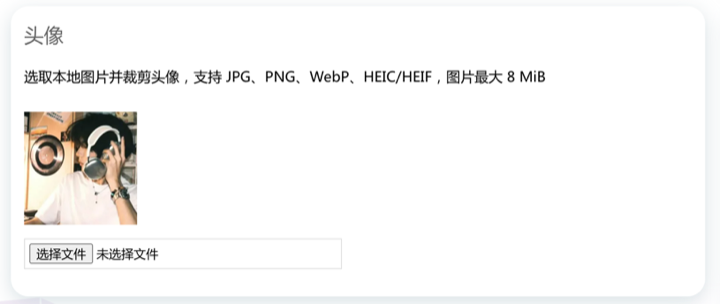
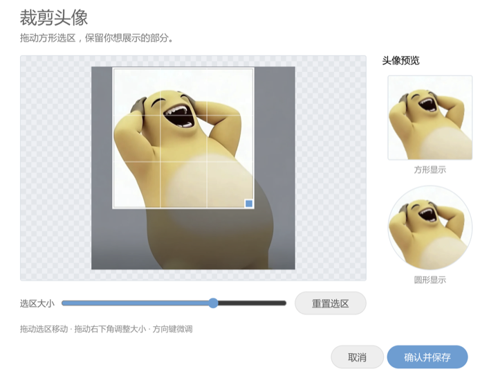
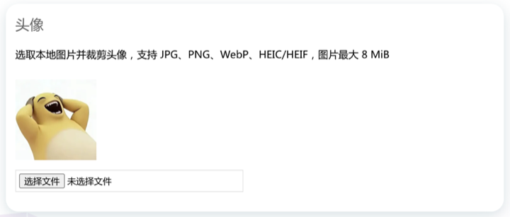

# hydrooj-avatar

Hydro OJ 本地头像裁剪上传与图片自动压缩插件。用户可以上传 JPG、PNG、WebP 和苹果 HEIC/HEIF 照片，选择方形区域作为头像；出题时粘贴或上传的大图片会在保存前自动压缩，减少存储占用和页面加载流量。

注意，安装该插件后，OJ将仅支持本地上传头像，其他方式将失效。

## 使用场景
1. 部分在学校或机构内网下运维的OJ，服务器本身可能就是断网的，因此所有用户必须是本地上传的头像才能正常显示；
2. 原生的Hydro OJ上传的头像，并非是以1:1的形式保存的，最好是裁切成1:1的图片保存会比较好；
3. 部分用户如果上传超大体积的头像图片，可能会对带宽造成极大的压力；
4. 出题者在题目中上传的图片很多时候都是超大体积的高清图，对带宽造成极大压力。

## 作为 Hydro 插件安装

以下命令均使用运行 Hydro 的用户执行。

```sh
hydrooj install hydrooj-avatar
pm2 restart hydrooj
```

安装完成后会自动注册插件，重启 Hydro 即可使用。

插件的前端脚本和模板由 Hydro 启动时自动加载，无需单独构建或修改 Hydro 源码。

## 更新插件

重新执行安装命令即可更新：

```sh
hydrooj install hydrooj-avatar
pm2 restart hydrooj
```

## 在 Hydro 中使用

### 上传头像

1. 打开账户设置页面 `/home/settings/account`，可以看到头像设置的界面：



2. 在头像区域选择合适的本地图片后，会进入到图片裁剪界面：

拖动方形选区选择位置，用滑块或右下角手柄调整大小；右侧实时显示方形和圆形头像预览。支持触屏拖动，也可用方向键微调位置，按住 Shift 加速移动。


3. 点击“确认并保存”，成功后页面自动刷新。点击“取消”或按 Esc 退出，保留当前头像：



头像区域直接显示文件选择，只提供本地上传。支持 JPG、JPEG、PNG、WebP、HEIC/HEIF，原图最大 8 MiB。

安装插件前已有的头像会继续保留，需要重新上传才会进行裁剪和压缩。

### 题面图片与附件

正常在题面编辑器中粘贴图片，或在文件管理页面上传图片即可，无需额外操作。插件也会处理个人文件、比赛附件和导入题包时保存的题目图片附件。

- 不超过 500 KB 的图片保持原内容。
- 超限 JPG/JPEG、PNG、WebP、GIF、AVIF 使用各自的编码策略；大图先通过小样估算合适尺寸，再按实际结果调整，减少反复全尺寸编码，保存结果不超过 500 KB。
- 保留普通图片的文件名、格式和引用地址；GIF 和动画 WebP 保留动画。
- 超限 HEIC/HEIF、SVG、BMP、TIFF、ICO、JXL 等暂不能保留原格式压缩的图片会提示拒绝保存，可先转换为支持的格式。头像上传独立支持 HEIC/HEIF 转 WebP。

判题测试数据、提交代码和非图片文件保持原样。插件只处理上传保存过程，不会自动扫描或重写历史文件。

## 处理限制

| 项目         | 头像                      | 普通图片               |
|--------------|---------------------------|------------------------|
| 原图大小上限 | 8 MB                      | 20 MB                  |
| 保存大小上限 | 100 KB                    | 500 KB                 |
| 保存尺寸     | 正方形，最大 256 × 256 px | 根据压缩结果等比例调整 |
| 保存格式     | WebP                      | 保留原格式             |

图片在服务器接收后自动处理。遇到处理繁忙、超时或图片无法解码时，页面会显示错误提示，可稍后重试或更换图片；压缩失败的超限图片不会保存。

已有服务器请求大小限制仍然生效。直接通过外部工具写入磁盘的图片不会触发压缩。

## 许可

本插件以 [AGPL-3.0-or-later](LICENSE) 发布。
